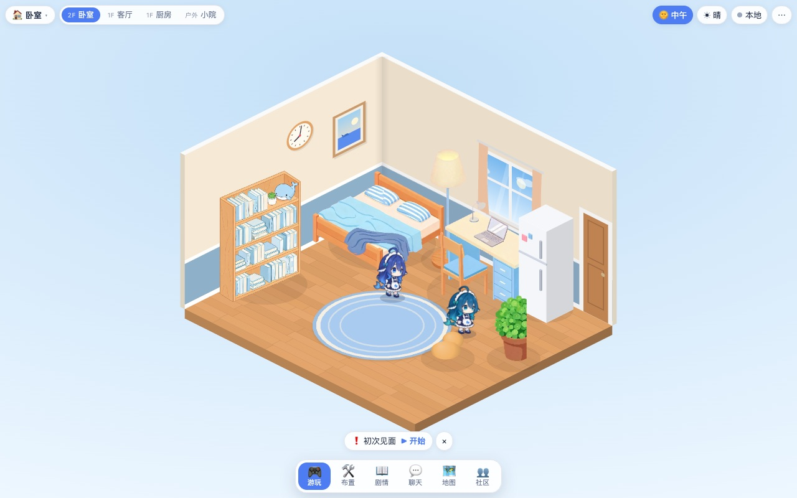
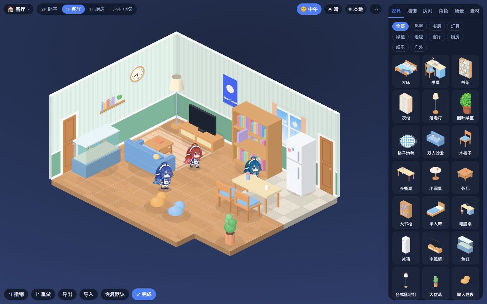
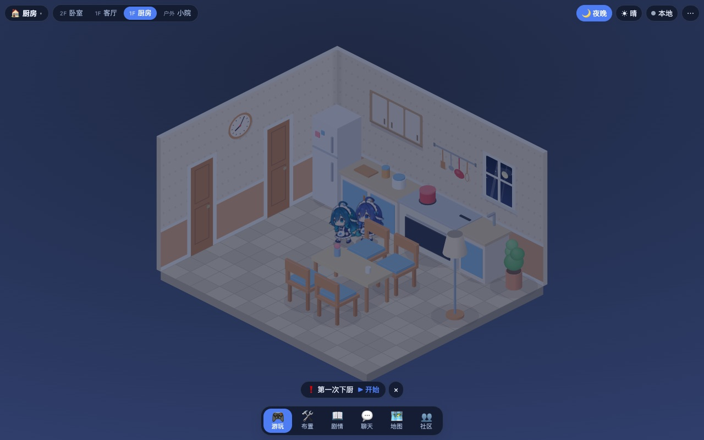
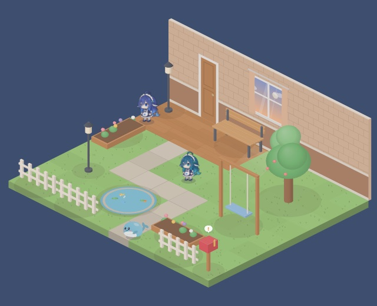

# 大肥鱼的房间

一个可布置的 2.5D 小屋。鲸鱼娘住在里面，会自己做饭、睡觉、看书，也会跟着 DSH 的工作状态忙前忙后。

同一份代码可以作为 [DSH](https://github.com/deepseek-ai/deepseek-harness) 插件、独立网页和透明桌面窗口运行。

先给自己的 AI 一个可以生活和布置的房间，再把作品分享给愿意来访的人。长期希望从一座公共公园起步，让玩家贡献的场景逐步连接成共同世界。

先在 [网页试玩](https://mu2a.penguingugu.com/) 看看效果。已有 DSH 的用户可以直接安装本仓库，在 DSH 里打开房间，再把同一个家放到桌面。创作分享和共同世界按 [当前路线](docs/10-AI世界分阶段开发计划.md#0-当前发布路线) 逐步推进。



| 布置 | 厨房 | 桌面 |
|---|---|---|
|  |  |  |

## 功能

- 多房间的家，包含卧室、客厅、厨房和后院，带时间与天气变化。
- 家具摆放、换色、撤销，以及场景导出与导入。
- 角色按精力、乐趣和社交需求自主行动。
- 在 DSH 中显示工作状态，并支持和角色聊天。Agent 工具默认关闭，可选开启。
- 家具、场景和剧情都是数据，可以用内容包扩展。
- 世界分享原型：发布固定场景版本、邀请朋友进入、共同完成信标活动并保存本机经历。公开推荐区域的登录和入场已在 mu2a 提供。

## 安装到 DSH

1. 打开 DeepSeek Harness，进入「插件」→「添加插件」。
2. 粘贴下面的仓库地址，点击「安装」。
3. 安装完成后点「立即启用」，从插件入口打开「大肥鱼的房间」。
4. 先试试换房、点灯、和角色聊天，再点击「放到桌面」。

```text
https://github.com/HarrisonDo/dsh-room
```

不用下载源码、运行终端命令或自己构建。房间使用 DSH 中已经选好的模型；没有模型时，仍可换房、布置和手动互动。打开本地房间不需要注册公共世界账号。

首次放到桌面会自动下载并校验桌面运行组件，界面显示进度，可取消后重试。后续直接使用缓存。DSH 需要保持运行；桌面右键菜单可回到 DSH，房间布置和角色会一起接续。桌面辅助窗也可以打开完整房间继续编辑。

[安装说明与备用下载](https://mu2a.penguingugu.com/assets/dsh-install.html) · [安装与桌面使用指南](docs/17-安装与桌面使用.md) · [反馈问题](https://github.com/HarrisonDo/dsh-room/issues)

仓库根目录分发已经构建好的验收版本，版本和逐文件校验值在 [release.json](release.json)。`install/` 是该版本的分发快照，开发源码位于 `dsh-room/` 和 `desktop/`。普通用户只需上面的仓库地址；参与开发请看下方「开发」。

Windows 桌面路径已有实现，实机验收尚未完成。macOS 的实际验收范围和未完成项见 [发布记录](docs/12-开发交接与进度.md)。网页试玩与本机 DSH 的存档各自保存，跨设备账户同步仍在后续计划中。

## 基本操作

底部菜单提供游玩、布置、场景、角色和剧情。点地面让角色走过去，点家具互动，点角色打开动作卡片。

游玩时左键房门直接换房，右键打开门旁气泡菜单；布置模式仍用于选中和移动物件。

DSH 中按 `Alt+Shift+R` 切换房间小窗。

同一 DSH 宿主内的房间和桌面辅助窗轮流接管同一个本地家，切换时会保存家具包与世界草稿。它们与公网网页试玩的存档不自动同步。独立 Electron 源码入口用于开发，不等于插件内的桌面接续。

## 文档

| 文档 | 内容 |
|---|---|
| [安装与桌面使用](docs/17-安装与桌面使用.md) | 粘贴仓库安装、桌面接续与常见问题 |
| [AI 世界方向与产品边界](docs/09-AI世界方向与产品边界.md) | 当前产品方向、首版流程、平台与用户的职责 |
| [AI 世界分阶段开发计划](docs/10-AI世界分阶段开发计划.md) | 现有代码复用、改造任务、依赖和验收 |
| [AI 世界首版契约](docs/11-AI世界首版契约.md) | 世界格式、邀请、共享状态、AI 与经历边界 |
| [开发交接与进度](docs/12-开发交接与进度.md) | 当前任务顺序、状态与接续记录 |
| [Web 入口与三端 UI 改造交接](docs/13-Web入口与三端UI改造交接.md) | 交给 Opus：游客预览、登录、公共世界、邀请与家具界面 |
| [三端账号与数据同步方案](docs/14-三端账号与数据同步方案.md) | Web、DSH、Electron 的身份、存档、素材、经历与控制权 |
| [接入说明](docs/07-接入说明.md) | 嵌入网页、命令接口、DSH 路由、AI 小镇 |
| [AI 小镇上线计划](docs/08-AI小镇上线计划.md) | 旧小镇原型的账号、审核、记忆与部署记录 |
| [小镇部署](deploy/town/README.md) | Docker Compose 部署、迁移、备份恢复 |
| [内容格式规范](docs/04-内容格式规范.md) | 内容包、家具、场景和剧情格式 |
| [引擎说明](dsh-room/web/README.md) | 运行参数、命令示例、目录结构 |
| [架构与路线图](docs/03-RoomKit架构与路线图.md) | 引擎设计 |
| [早期房间开发计划](docs/05-完整开发计划.md) | 旧版房间、DSH 与社区路线的历史记录 |
| [DSH 插件契约](docs/01-DSH插件契约备忘录.md) | 插件接入的约束 |

`docs/02` 和 `docs/06` 是历史诊断与修复记录。部分文档提到的 `参考/` 是本地参考资料，不在本仓库中。

接续开发从 `docs/12` 的「当前建议领取」开始，当前顺序是 `docs/10` 第 0 节的安装分发路线。`docs/13–16` 保留 UI 与同步设计及实现交接，不作为自动扩大本轮范围的依据。实际已经实现的行为以源码与验证记录为准。

## 开发

```sh
cd dsh-room
npm ci
npm run build
npm test
```

| 目录 | 内容 |
|---|---|
| `install/`、`package.json` | GitHub 直接安装入口和已验收载荷，请勿手改 |
| `dsh-room/web/` | RoomKit 引擎、默认内容包和构建产物 |
| `dsh-room/lib/`、`dsh-room/src/` | DSH 插件的宿主端和客户端 |
| `dsh-room/room/` | 旧版引擎，保留 Coopanion 源码与许可证 |
| `desktop/` | Electron 透明桌面壳 |
| `dsh-room/scripts/town*.mjs` | AI 小镇服务端 |
| `deploy/town/` | 小镇的 Docker Compose 部署 |
| `docs/` | 设计与接入文档 |

## 许可

本仓库的代码按 AGPL-3.0 发布。源码仓库保留可选 Coopanion 鲸鱼模型，其许可证保留在 `dsh-room/room/vendor/coopanion/`。Q 版鲸鱼娘演示候选使用 Canvas 绘制，包内署名与所含内容见候选的 NOTICE。 [仓库许可证](LICENSE) · [Coopanion](https://github.com/Pal-AI-Lab/Coopanion) · [演示候选署名](dsh-room/release-dsh/NOTICE.md)

「大肥鱼」鲸鱼娘形象是社区二创，按 CC BY-NC-SA 4.0 授权，**不可商用**。这项限制独立于 AGPL，单独适用于形象素材。使用形象时需保留署名，并按相同方式共享。

本项目是社区插件，不是 DSH 官方项目。
